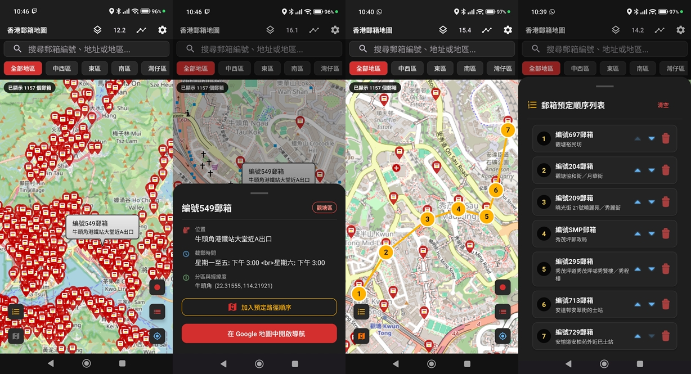
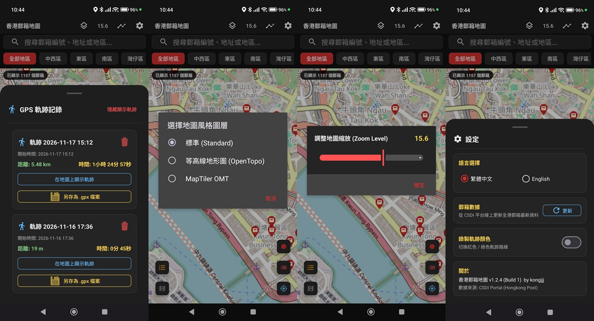

  
# 香港郵箱地圖 (HK Post Box Map) 📮🗺️
一個基於 Android、OpenStreetMap (osmdroid) 及香港 CSDI (空間數據共享平台) Open Data 打造的完整郵箱地圖與 GPS 行山軌跡記錄應用程式。
  

## 🌟 Key Features
- 📮 Complete Map Mapping of All 1,157 Street Postboxes in Hong Kong:
  - Connects to the CSDI API for real-time data retrieval, supplemented by a built-in offline GeoJSON fallback database.
  - Supports viewing postbox numbers, detailed addresses, districts, daily collection/cut-off times, and one-tap navigation via Google Maps.
- 🔍 Powerful Search & District Filtering:
  - Supports real-time search by postbox number, street, or area name.
  - Quickly switch across all 18 districts in Hong Kong (Central & Western, Yau Tsim Mong, Islands, Sha Tin, etc.).
- 🥾 Pro-Grade Background GPS Hiking/Route Tracking (Foreground Service):
  - Utilizes Android Foreground Service + WakeLock to continuously and accurately record GPS movement tracks even when the screen is locked, in your pocket, or switching apps.
  - Supports persistent system notification bar updates with real-time distance and duration calculations, plus free switching between Bright Red and Neon Green route colors.
  - Track files are automatically saved persistently and can be replayed anytime in the "View Track History" menu, highlighted on OpenStreetMap.
  - Tracks can be exported as .gpx files for use in external mapping applications.
- 🗺️ Custom Planned Postbox Walking Route:
  - Freely select multiple postboxes as targets to assemble an optimal walking navigation sequence (1, 2, 3...).
  - Real-time numbered badges and a golden planned route are displayed on the map; sequence data is automatically saved and restored (Auto-Save/Restore) even after restarting the app.
- 🎨 Charcoal Dark Mode & Authentic Bilingual Switching (Traditional Chinese / English).

## 🌟 主要功能與特色

- 📮 **全港 1,157 個街道郵箱完整地圖標註**：
  - 對接 CSDI API 實時讀取，同時內建離線 GeoJSON 備用資料庫。
  - 支持查看郵箱編號、詳細地址、所屬分區、每日截郵/收信時間，以及一鍵開啟 Google 地圖導航。
- 🔍 **強大搜尋與行政區篩選**：
  - 支援按郵箱編號、街道或地區名稱實時搜尋。
  - 快速切換全港 18 個行政區（中西區、油尖旺、離島區、沙田等）。
- 🥾 **專業級背景 GPS 行山/路徑軌跡記錄 (Foreground Service)**：
  - 採用 Android Foreground Service + 喚醒鎖 (`WakeLock`)，鎖屏、放口袋或切換 App 仍能連續精準記錄 GPS 移動軌跡。
  - 支援常駐系統通知列及里程/時間實時計算，可自由切換**鮮紅路線**與**亮綠路線**。
  - 軌跡檔案自動持久化儲存，隨時於「查看軌跡記錄」選單重現並在 OpenStreetMap 上高亮繪製。
  - 軌跡可匯出成.gpx檔案給外部地圖程式使用。
- 🗺️ **自訂預定郵箱步行順序 (Planned Route)**：
  - 可自由選擇多個郵箱為目標，組合出最佳步行導航順序 (1, 2, 3...)。
  - 地圖實時標示序號 Badge 及金黃色預定路線，順序資料自動持久化保存 (Auto-Save/Restore)，重啟 App 依然保留。
- 🎨 **炭灰黑暗色主題 (Dark Mode)** & **純正雙語切換 (Traditional Chinese / English)**。
- ✏️ **編輯模式功能：可編輯郵筒資訊、支援拖曳圖釘標記、長按地圖新增郵筒，及在更新資料時重置所有郵箱**。

## 🛠️ 技術棧 (Tech Stack)

- **Language**: Kotlin 1.9+
- **Architecture**: MVVM + Repository Pattern + StateFlow
- **Map Engine**: OpenStreetMap ([osmdroid](https://github.com/osmdroid/osmdroid) v6.1.20)
- **Background Service**: Android Foreground Service + FusedLocationProviderClient
- **UI Components**: Material Design 3, ViewBinding, BottomSheetDialogFragment, RecyclerView, ConstraintLayout
- **HTTP / JSON**: OkHttp3, Gson, CSDI Open API GeoJSON

## 📄 Data Credit
Dataset: Street Posting Box Information (郵箱資訊) provided by Hongkong Post via [CSDI Portal](https://portal.csdi.gov.hk/).
